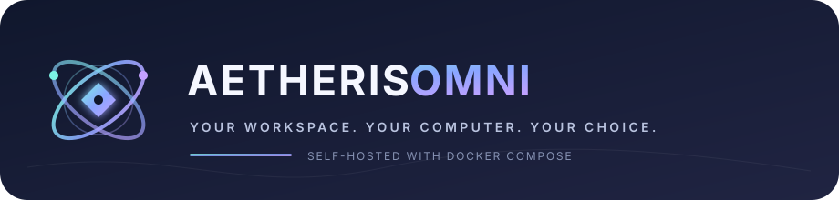

<p align="center">
  
</p>

<p align="center">
  <strong>One workspace. Self-host it locally or use the opt-in hosted BYOK edition.</strong><br />
  <sub>Open-source · Docker Compose · Hosted accounts · Your provider key and bill</sub>
</p>

<p align="center">
  <a href="https://github.com/rajaram-2005/ragam/archive/refs/heads/arena/e51ae7e1-ragam.zip"></a>
  <a href="#download-and-run-on-windows"></a>
  <a href="docs/27-provider-framework.md"></a>
</p>

<p align="center">
  <sub><a href="https://github.com/rajaram-2005/ragam/archive/refs/heads/arena/e51ae7e1-ragam.zip">Download ZIP</a> · <a href="#download-and-run-on-windows">Windows setup steps</a> · <a href="docs/27-provider-framework.md">Provider catalogue</a></sub>
</p>

# Aetheris Omni

Aetheris Omni is an AI workspace, not a model. Run the default single-user workspace locally with Docker at **http://localhost**, or deploy the opt-in hosted BYOK web edition for per-user accounts. In hosted mode, each person supplies an API key, Ragam encrypts it for that account, and the chosen provider bills that person directly. Public hosted registration requires a production email-delivery service; see [hosted BYOK setup](docs/30-hosted-byok.md).

> **Important distinction:** “hosted locally” describes where the Aetheris Omni app and its workspace run. It does **not** make every AI model local or offline. If you choose a cloud provider, the prompts you send go to that provider and its usage terms and charges apply. A local ComfyUI connection is optional for image generation; no model weights are bundled or downloaded by Aetheris Omni.

**Five product areas:** Chat · Image · Video · Plugins · MCP<br>
**Product version:** 0.2.0 · [Release notes](docs/26-release.md) · [MIT license](LICENSE)

## How Aetheris Omni is different

Aetheris Omni takes a deliberately self-hosted, provider-connected approach. These are architectural choices—not claims that every hosted AI product works the same way.

| Design choice | What it means in practice |
|---|---|
| **Choose the deployment boundary** | The default Docker setup runs a private single-user workspace locally. The separate hosted BYOK build serves account-backed Chat through Vercel and Supabase; it stores per-user encrypted provider settings, not hosted conversation history. |
| **You choose the AI connection** | Connect a supported provider and explicitly select a model it returns. Aetheris Omni does not silently switch providers or invent model listings. Provider API use may cost money; the app does not include or pay for it. |
| **Local mode stays local** | The default Compose setup binds to `127.0.0.1` and has no account or sign-in screen. Do not expose that unauthenticated mode to a LAN or public internet. |
| **External tools require deliberate approval** | Remote MCP and plugin calls are shown as external actions and require per-call approval. Ragam does not download and execute remote plugin code. |
| **Status is kept honest** | Contract-tested adapters and synthetic fixtures are not presented as live vendor verification or proof of model performance. |
| **Five clear product areas** | Chat, Image, Video, Plugins and MCP are the five primary areas. Provider Settings is a dialog, not a sixth area. |

### Where the app, data and prompts go

- **Local deployment:** app, conversation/workspace data, provider settings and generated files stay in the local Docker volume.
- **Hosted BYOK deployment:** Supabase Auth stores account identities; Supabase Postgres stores each user's encrypted provider key. Chat prompts and replies are not saved by the hosted Core and remain only in the current browser page unless the user copies them elsewhere.
- **Cloud AI requests:** when you configure and use a cloud provider, the request goes to that provider. Check its privacy, retention and pricing terms before sending sensitive information.
- **Localhost is not offline AI:** the browser address `http://localhost` means the app is on your computer. Chat with a cloud model still needs internet and sends the request to the selected vendor. No model weights are included.
- **Local-mode accounts:** the Compose app is intentionally single-user and has no email, account creation, sign-in or password reset. Keep the default loopback binding. Hosted mode uses Supabase Auth and requires verified email delivery for confirmation and password recovery.

## Download and run on Windows

This is a source-code download, not a conventional `.exe` installer. The checked-in Windows launcher guides the local Docker setup; you do not need to type terminal commands.

### Before downloading

1. **Have Docker Desktop installed.** If it is already installed, skip this step. Otherwise, download it from the [official Docker Desktop page](https://www.docker.com/products/docker-desktop/) and follow Docker's on-screen installation instructions. Docker Desktop and licensing terms are managed by Docker, not by this repository.
2. **Start Docker Desktop** and wait until it reports that its Engine is running. Leave Docker Desktop open while you use Aetheris Omni.
3. A first start needs an internet connection so Docker can download the app's build dependencies and container images. It does **not** download AI model weights.

### Download the project files

1. Open the [Aetheris Omni source repository](https://github.com/rajaram-2005/ragam/tree/arena/e51ae7e1-ragam) in your browser.
2. On GitHub, click **Code**, then **Download ZIP**. Save the ZIP somewhere you can find it, such as your Downloads folder.
3. In File Explorer, open Downloads, right-click the ZIP, and select **Extract All…**. Choose a folder you can keep, then click **Extract**. Do not try to run the launcher from inside the ZIP preview.
4. Open the extracted project folder. You should see files such as `compose.yaml` and the `scripts` folder. Keep this folder; it is the project source used to build and update the app.

### Start the local app

1. Confirm Docker Desktop still says its Engine is running.
2. In the extracted folder, open **scripts**, then double-click **Start-Ragam.cmd**. The repository and launcher still use the technical name “Ragam”; the product name in this guide is **Aetheris Omni**.
3. The launcher checks Docker, creates a local `.env` from safe defaults if needed, builds and starts the containers, and opens your browser at **http://localhost**. The first build can take a while. Let it finish; do not close Docker Desktop during startup.
4. If the page does not appear immediately, wait for the build/startup to finish and refresh `http://localhost`. For errors, see the [Windows setup and troubleshooting guide](docs/22-self-hosted-deployment.md).
5. The end-user Docker app has no email, account creation or sign-in flow; the workspace is ready without registration. Nothing contacts an AI provider until you configure/test a connection or send a request.

### Connect a provider (optional)

1. In the app, open **Provider Settings**.
2. Choose a provider you already have access to and **connect your own provider key** by entering its API key in the provider form. Do not paste a key into a chat message, issue, or support request.
3. Save the connection and explicitly choose **Test connection**. Provider API access is separate from consumer subscriptions (for example, ChatGPT or Claude subscriptions may not include API usage). Provider usage may incur charges; check its current terms and pricing directly.
4. In Chat, choose a model returned by that provider. Aetheris Omni does not silently choose a replacement if the selected provider or model fails.

The app itself does not provide a hosted AI subscription, provider credentials, paid tier or bundled inference. The [provider matrix](docs/27-provider-framework.md) distinguishes supported API contracts from live verification; no live vendor call is implied by a fixture test.

### Stop, restart and protect your data

- To stop the containers but keep your workspace, double-click **scripts/Stop-Ragam.cmd**. Start again with **scripts/Start-Ragam.cmd**.
- To make a backup or restore one, double-click **scripts/Backup-Ragam.cmd** or **scripts/Restore-Ragam.cmd** and follow the file pickers. Store both the archive and checksum together on an encrypted drive; backups contain private workspace data and provider settings.
- Do **not** delete the Docker volume or use a “remove volumes” option for routine stopping or updates. That volume holds your workspace.
- Keep the default `127.0.0.1` binding. Because this app has no sign-in, do not change the bind address, forward port 80, expose it to a LAN/public network or put it behind a remote proxy. See the [security and persistence guide](docs/22-self-hosted-deployment.md).

## Supported user interfaces

| Interface | What you use it for |
|---|---|
| **Windows launcher** | Double-click [`scripts/Start-Ragam.cmd`](scripts/Start-Ragam.cmd). Docker Desktop must be running. |
| **Browser app** | Open `http://localhost`. Caddy serves the UI and forwards same-origin `/api` requests to your local Core service. |
| **Stop without deleting data** | Double-click [`scripts/Stop-Ragam.cmd`](scripts/Stop-Ragam.cmd). Docker volumes and data remain. |
| **Backup / restore** | Double-click [`scripts/Backup-Ragam.cmd`](scripts/Backup-Ragam.cmd) or [`scripts/Restore-Ragam.cmd`](scripts/Restore-Ragam.cmd). Use an encrypted location for sensitive archives. |
| **Other Compose-compatible platforms** | Use [`compose.yaml`](compose.yaml) with its loopback-only default. The same no-login security boundary applies. |

Aetheris Omni supports a local Docker workspace and a separate opt-in hosted BYOK web edition; see [the hosted setup guide](docs/30-hosted-byok.md) for its security boundary and launch prerequisites. The hosted scope currently provides account-backed Chat and Provider Settings, not every local-workspace area.

## Product capabilities and current limits

The product has exactly **five primary areas: Chat, Image, Video, Plugins and MCP**. Provider Settings is a dialog; history, memory, safety and other internals stay inside the relevant areas.

- **Chat:** 22 individually adapted Chat APIs have contract-tested integrations. Contract tests do not prove current live access, latency or model quality. Choose a provider and model explicitly; no silent fallback.
- **Image and Video:** these use separate provider connections. Image has ten adapters (including optional local ComfyUI); Video has five. Model weights are not shipped with the app.
- **Plugins and MCP:** reviewed built-ins plus owner-managed HTTP/Streamable HTTP connections. Remote calls need explicit approval; downloaded remote code is not executed.
- **Provider catalogue:** currently 47 entries, including one pending entry. A listed consumer product is not automatically an API integration; only documented public APIs are represented. The catalogue is not an exhaustive inventory of every provider worldwide.
- **Verification:** the catalogue distinguishes adapter status from live vendor verification. Tests use synthetic fixtures and make no vendor calls. No provider has been live-qualified as part of this repository work.

For full evidence and technical details, see the [provider framework](docs/27-provider-framework.md), [product status](docs/03-status.md), [self-hosted deployment guide](docs/22-self-hosted-deployment.md), and [release notes](docs/26-release.md).

## Project and engineering documentation

This repository is named `ragam`, and some code, container and launcher filenames retain that implementation name. **Aetheris Omni** is the product-facing name used in this README. The stack is Docker Compose only; the Node/Vite commands later in this README are for repository development, not end-user installation.

---

## Retained legacy architecture and verification history

The following documents the earlier research foundation. Its local/offline capabilities are not part of the active product.


An **online-first** AI platform built by integrating two repositories into one system:
[`Aetheris-`](https://github.com/rajaram-2005/Aetheris-) (application and
orchestration) and [`sparsiz`](https://github.com/rajaram-2005/sparsiz) (research and
compute optimisation). The active product is online-only: chat, image and video requests go to
the provider connection you configure, and an internet connection is required for AI
functionality. Local runtimes (Ollama, llama.cpp, vLLM, LocalAI) remain optional developer and
self-hosted integrations and do not dictate the architecture. Optional catalog metadata refresh
is separate from inference consent.

This is **not** a concatenation of the two. Each was audited first
([`docs/01-audit.md`](docs/01-audit.md)), responsibilities were assigned by
capability, duplication was removed, and conflicting interfaces were resolved.
Provenance for every adopted piece is in
[`third-party/NOTICES.md`](third-party/NOTICES.md).

---

## Five product areas

**Chat · Image · Video · Plugins · MCP**

Nothing else is a top-level section. Upstream Aetheris exposed twelve navigation
entries; training, memory, safety, model management, God Core orchestration,
benchmarking, resource management and execution control are now **internal
services** surfaced inside the five areas that need them. The mapping is recorded
in code (`apps/web/src/areas.js`) and enforced by a test — a sixth area, or any
internal service promoted to a navigation entry, fails the build.

| Area | What it does | Current boundary |
|---|---|---|
| **Chat** | Sends prompts to the explicitly selected model through the configured provider; supports streaming, optional conversation history, approved memory, and text-file knowledge with citations. | Inference is online-only. A reachable provider and its own credentials are required; no silent model fallback. |
| **Image** | Submits image-generation jobs through the supported provider adapters and shows job state and validated output. | Requires a configured provider. Adapters are contract-tested; live vendor qualification is still pending. |
| **Video** | Submits video-generation jobs, exposes progress/cancellation, and validates that the result is genuine video rather than a still image. | Requires a configured provider. No video model or inference runtime is bundled locally. |
| **Plugins** | Reviewed built-ins plus owner-managed Ragam HTTP plugin connections, with manifest/schema validation and permission preflight. | Remote plugin code is never downloaded or executed. The remote endpoint receives arguments only after per-call consent; only `service.external` scope is grantable. |
| **MCP** | Reviewed in-process servers plus owner-managed Streamable HTTP connections, discovered tools, schema checks and risk gates. | Remote tool calls are always classified as external and require per-call approval. Remote results remain untrusted data. |

Image and Video requests go to the provider you choose; their adapters and synthetic
fixtures do not establish live-provider performance. Provider Settings and the model
picker are controls inside the app, not additional product areas.

| Internal service | Where it appears |
|---|---|
| Model routing | Chat → routing decision, candidates, rejection reasons |
| Model management | Chat → registered models table |
| Private knowledge pipeline | Chat → ingest, search, citations, retention |
| God Core lifecycle | Chat → eight-phase task lifecycle with budgets and verification |
| Safety / data classification | Chat composer + per-message classification chips |
| Resource management | Sidebar hardware card; Image and Video echoes |
| Media validation | Image/Video → job detail, rejection reasons, artifact sha256 |
| Execution control | Image/Video job cancellation; Chat generation Stop; task pause/resume/cancel |
| User-authorized adaptation/training | Chat → “Create or adapt model weights”; paired user-computer worker, explicit disclosure/consent, verified-base and resource gates. Interactive lightweight adaptation is capped at 120 seconds from the Execute action through worker setup/finalization. Foundation pretraining is a separate mode; research benchmarking and model-card publication remain separate workflows. |

---

## Developer quick start

```bash
# Core uses Node's standard library; it has no dependency install step.
AETHERIS_LOCAL_SINGLE_USER=true node services/core/src/server.mjs  # Core on 127.0.0.1:8790; no account/email flow

# In another terminal, install the locked Web dependencies and start the UI.
npm ci --prefix apps/web
npm run web                               # UI, proxies /api to core
```

For the optional Fabric service and its test tools, install into an isolated
virtual environment (macOS/Linux):

```bash
python3 -m venv services/fabric/.venv
services/fabric/.venv/bin/python -m pip install -e 'services/fabric[dev]'
# Point the test runner at that environment when running all suites:
AETHERIS_PYTHON="$PWD/services/fabric/.venv/bin/python" npm test
```

The root `package.json` is a script runner, not a dependency workspace. The only
npm dependency tree is `apps/web`; `npm ci --prefix apps/web` installs it from the
lockfile. Core has zero npm dependencies. Fabric needs NumPy at runtime and pytest
for tests; the `[dev]` extra installs both. **Do not install PyTorch** for normal
setup or tests—no GPU or model weights are required.

Requirements: **Node ≥ 22.12** — the core service needs ≥ 22.5 for `node:sqlite`
and the web app's build tooling (Vite 8) needs ≥ 22.12, so the higher bound
applies — and, for Fabric, **Python ≥ 3.11 + NumPy**. No GPU. No model weights are
downloaded.

```bash
npm test          # 1950 tests: core 1000, web 128, fabric 822
npm run lm:quick  # 60-step Aetheris Lite LM smoke run (seconds, no GPU)
npm run lm:train  # the full from-scratch LM run (~35-40 min on 2 CPUs)
npm run train     # in-process training run
```

The optional real Qwen LoRA smoke path is separate from normal setup. On a machine
with internet access and about 8 GB RAM (a Codespace is sufficient), it bootstraps
its own reviewed torch/Transformers/PEFT packages and uses CPU when no GPU exists:

```bash
python services/fabric/remote/run_smoke_local.py --workdir ./aetheris-smoke
# then inspect aetheris-smoke/status.json
```

CI runs the full suites on every push and pull request
([`.github/workflows/ci.yml`](.github/workflows/ci.yml)) across six jobs: one per
component, a Docker Compose build/health/persistence/restore smoke, documentation
checks, and release verification against suite counts. The latest completed full CI run
[41394564087](https://github.com/rajaram-2005/ragam/actions/runs/41394564087) passed all
1,916 tests (Core 985, Web 109, Fabric 822), plus release verification and the
loopback-only Compose persistence/restore smoke. Since then, follow-on onboarding, history, project organization and Chat parity work have expanded the test suites. The current tree has 1,950 tests (Core 1,000, Web 128, Fabric 822). In this sandbox the full Core run was 989/1,000: 11 model/training tests could not pass because the ignored Klyvaron artifacts and Python NumPy prerequisite are not installed. Web passed 128/128; docs/release passed 64/64. The prior full local run passed with the pinned Python environment and digest-verified Klyvaron artifacts; full CI for this current tree is pending. The added Chat API paths use deterministic contract fixtures;
neither the tests nor CI made live vendor calls. The
Fabric job asserts the release gate in **both** directions: a trained model must
release, and an undertrained one must fail *and* must not become the current model.

End-user setup and troubleshooting: [`docs/22-self-hosted-deployment.md`](docs/22-self-hosted-deployment.md). Developer environment variables and repository setup: [`docs/04-setup.md`](docs/04-setup.md).

> **Do not `pip install torch` for normal development or tests.** The Fabric service
> is NumPy-only. Only the explicit optional LoRA command above bootstraps torch and
> its model stack; use that runner rather than adding torch to Fabric's dependencies.

---

## What actually works

On a machine with **no language model installed** — which is the default state of
this repository — the core service reports:

```
readiness     degraded
local models  0 ready
limitation    no local chat model is installed; /api/chat will return no_model_available
limitation    no video generation model is available; /api/video will refuse rather
              than substitute a still image
```

That is the correct output, not a failure. Install Ollama, pull any chat model,
re-probe, and the same code path serves real inference
([`docs/04-setup.md` §6](docs/04-setup.md)).

Verified by test, on this host, with no external service:

- **Offline enforcement is real, not cosmetic.** A recording `fetch` spy proves
  `api.openai.com`, `api.example.com`, `huggingface.co` and `api.anthropic.com` are
  rejected under `strict_offline` without opening a socket or resolving DNS — while
  a real loopback server speaking the Ollama wire protocol still completes a genuine
  chat round-trip. Offline does not mean nothing works.
- **No credential reaches a response.** Seven endpoints swept for a configured API
  key and any prefix of it; `publicConfig` carries `keyConfigured: true`, never a
  value.
- **A still image is never presented as generated video.** Magic-byte sniffing plus
  `assertGenuineVideo` fail the job with the reason recorded and the refusal audited.
- **Plugin and MCP permissions hold.** A missing required argument is `403`;
  an unapproved destructive tool call is `409`; granting an elevated scope is *not*
  consent to use it — an approval must name the scope.
- **Unvalidated weights cannot replace a release.** A 3-epoch run scores below the
  MRR floor, so release fails and `released` is `null`.
- **A plan-only task never reports success.** It ends `partial`, naming the heuristic
  intent detection, the absent executor and the unverified results.

Status of every acceptance criterion, with evidence:
[`docs/03-status.md`](docs/03-status.md).

---

## Components

| Component | Stack | Source lines | Test lines | Dependencies | Tests |
|---|---|---|---|---|---|
| `services/core` | Node 22 ESM | 39,019 | 25,773 | **zero npm packages** | 1000 |
| `services/fabric` | Python 3.11 | 17,241 | 10,540 | NumPy only | 822 |
| `apps/web` | React 18 + Vite | 7,112 | 2,383 | pdfjs-dist, react, react-dom | 128 |

The core service has **no npm dependencies at all** — that is why the root
`package.json` is a script runner rather than an npm workspace: hoisting the web
app's 59-entry dependency lockfile over it would give the core a dependency surface it does not
have and make that property unverifiable.

Architecture, component responsibilities and enforcement points:
[`docs/02-architecture.md`](docs/02-architecture.md). Cross-provider assistant feature-parity audit and staged roadmap:
[`docs/29-assistant-platform-parity.md`](docs/29-assistant-platform-parity.md).

---

## Aetheris Lite

Three first-party artifacts exist, and all three are real.

### A language model, trained from nothing

**`aetheris-lite-lm@0.1.1`** — a **359,616-parameter character-level transformer**
trained from random initialisation, in pure NumPy, on this repository's own text.
No pretrained weights, no PyTorch, no GPU, no downloads. It supersedes
`@0.1.0` (359,136 parameters), whose figures stay published as a superseded record.

This exists because every route to *fine-tuning someone else's* model was blocked —
`huggingface.co` and `download.pytorch.org` are unreachable, `llama-cpp-python` ships
no manylinux wheel for this platform, and there is no `.gguf` or `.safetensors`
anywhere on the host. Training from random initialisation needs none of that.

The gradients are derived by hand and **every one is checked against a central finite
difference**. That check found a real bug on its first run: the positional-embedding
gradient scattered with a `(T, B)` layout while the hidden state is `(B, T)`. It
reported `pos: exceeds tolerance by 1.6e-01` and nothing else would have noticed.

> **This is not a good language model, and it is not presented as one.** Its output is
> mostly meaningless. It proves the pipeline — data validation, a disjoint split,
> hand-derived backprop, held-out evaluation against computed uniform/unigram/bigram
> baselines, a versioned card and a release gate that refuses. Its limitations are
> generated onto its own model card, not tucked into a footnote.

It **is** reachable from `/api/chat`, and that is the point rather than an oversight:
the artifact is registered as a local provider, an ordinary request is refused with
`model_not_instruction_tuned` (**501**) unless the model is pinned by id, and a pinned
request returns a continuation labelled as one, carrying the model's own limitations.
The model never answers as if it were an assistant. See
[`docs/08-aetheris-lite.md`](docs/08-aetheris-lite.md) and
[`docs/11-klyvaron-family.md`](docs/11-klyvaron-family.md).

The family does not compete. It is built for two things instead — knowing what is
current, with a date and a source, and understanding what the user expressed across a
session, quoted from their own words — and it refuses benchmark-superiority claims in
code rather than in a disclaimer. Pro and Max are **unbuilt** and **this family's own
models**: presets of `aetheris-core-v1` trained from random initialisation, with the two
differentiators as parts of the model rather than wrappers around it, on the user's own
accelerator (CUDA, ROCm, Metal, Vulkan, an OpenVINO GPU or NPU). No third-party weights are
involved anywhere in the plan — and no weights exist yet. See
[`docs/22-klyvaron-differentiation.md`](docs/22-klyvaron-differentiation.md) and
[`docs/23-training-free-tiers.md`](docs/23-training-free-tiers.md) — and
[`docs/24-own-models.md`](docs/24-own-models.md), which records the decision that Pro and Max are
trained models of this family's own architecture rather than someone else's weights behind a tier label.

### A second language model, on a corpus that was assembled and licensed

**`klyvaron-mini-lm@0.1.0`** — a **1,421,952-parameter character-level transformer**, the `mini`
preset of the same `aetheris-core-v1` architecture, trained from random initialisation on **9.87 MB
of text assembled from seven licence-checked sources**: this repository's own text plus
`pallets/flask`, `expressjs/express`, `psf/requests`, `microsoft/TypeScript`, `pytest-dev/pytest` and
`pallets/click`. Every source is pinned to a commit SHA and its licence is read **at that commit**.
`numpy/numpy` was **refused** — GitHub reports its licence as `NOASSERTION` — so it contributed zero
bytes rather than a note that someone thought it looked permissive.

The evaluation split is **held out by source**: `pallets__click` and `psf__requests` are validation
in their entirety and supply **not one byte** of training text. On those 1,907,072 held-out
characters it reaches **perplexity 4.7342** against a bigram baseline of **15.8644** — 29.8 % of the
baseline, 3.35× better than the best non-neural one. That is a harder test than the Lite model's
file-disjoint split, and the two perplexities are not comparable with each other.

It took **8,456 s (2 h 21 min) on two CPU cores**, and the release gate recorded **one soft failure
rather than waiving it**: the wall-clock target is 3,600 s. The miss is on the card and in its
limitation list. The run's command, config, digests and outcome are in
[`docs/experiments/klyvaron-mini-lm-run.json`](docs/experiments/klyvaron-mini-lm-run.json), which
carried `status: running` until the run exited and was not written ahead of it.

> **Its output is no better in kind than the Lite model's**: character-level text shaped like source
> code and mostly meaningless. `mini` is **not a tier** and it moves nothing — Pro and Max stay
> unbuilt. What it is for is making the whole recipe real: corpus assembly, licence checking, a
> tokenizer fitted on the training split only, training, evaluation and a release gate that refuses.
> It has **not** been exported to the runtime's artifact format or verified there; that path exists
> and has not been run for these weights.

Model card: [`docs/model-cards/klyvaron-mini-lm-0.1.0.md`](docs/model-cards/klyvaron-mini-lm-0.1.0.md).

### Hardware-based execution

Klyvaron **Lite / Pro / Max** are online deployment profiles: cost-conscious hosted inference for
Lite, higher-capability hosted models for Pro, and benchmarked high-performance or distributed
inference for Max. The hardware and local-runtime machinery described below belongs to the retained
legacy service and optional self-hosted use; it is not a requirement of the active product, which
performs **no local inference and downloads no models**. Where a Klyvaron-branded feature uses a
third-party hosted model, its metadata names the actual model and provider rather than claiming
first-party weights.

The admission framework, CPU memory safeguards, and [evaluated weight-only int8
inference](docs/14-cpu-int8-inference.md) are implemented. A useful
quantized Lite assistant, native mobile packaging, and benchmark-qualified Pro/Max
models remain release gates. See [the policy and acceptance matrix](docs/13-hardware-execution-policy.md).

### The retriever

**`aetheris-lite-retriever@0.1.0`**, a 18,784-parameter dual encoder trained from
scratch by a hand-written NumPy Adam loop whose five parameter gradients all match
central finite differences to ~3e-10. Trained from scratch, not a fine-tune:
`baseCheckpoint: null`.

On held-out queries at low lexical overlap it scores **MRR 0.8497 against BM25's
0.3352** (+153.5%), with an untrained control at 0.0500. The experiment ledger
verdict is `accept`.

> **This is not a claim that Aetheris beats Mistral, Qwen, Llama, Gemma or
> DeepSeek.** None of those could be installed on this host, so no such comparison
> exists, and none is implied anywhere in this repository. The only comparison made
> is against BM25 on identical hardware, corpus, tokeniser and query strings.

The model also **loses** to BM25 on a held-out-topic split (unseen vocabulary):
MRR 0.0937 vs 0.3820. That result is kept and reported rather than dropped. And
under high lexical overlap the ledger **rejects** the model outright, because BM25
already achieves recall@5 = 1.0 and the dense model regresses it to 0.9167 — a
guard metric doing its job.

Full numbers, conditions, fairness controls and reproduction commands:
[`docs/06-benchmarks.md`](docs/06-benchmarks.md).
Model card: [`docs/model-cards/aetheris-lite-retriever-0.1.0.md`](docs/model-cards/aetheris-lite-retriever-0.1.0.md).

Three of eight pipeline stages are **blocked** on this host — SFT, preference
optimization and distillation all need weights, and the first and third need a GPU.
They are named as blocked, with reasons, in every run record. The pipeline reports
`partial`, never `completed`.

---

## Security

Enforcement lives entirely in `services/core`. The browser is a display.

- **Three runtime policies** — `strict_offline` (default), `hybrid`,
  `online_enabled`. A blank or invalid policy **fails safe to `strict_offline`**
  and records a warning; it never fails open.
- **Company data stays local by default.** `confidential` and `restricted` content
  needs explicit per-request authorization to leave the machine, even in `hybrid`.
- **Sixteen secret patterns**, including env-var-style credentials (`\bsecret\b`
  cannot match inside `AWS_SECRET_ACCESS_KEY` — that gap was found and fixed),
  PEM blocks, JWTs and credentials in ordinary HTTP URLs. Redaction runs before
  egress and is audited.
- **All tool output is untrusted** — schema-validated, size-bounded, control
  characters neutralised, marked `untrusted: true`, never executed as instruction.
- **Scopes are an allowlist.** Seven elevated scopes always need per-call approval;
  four (`credentials.write`, `policy.override`, `godcore.bypass`, `audit.erase`)
  can never be granted.
- **Append-only audit ledger.** Refusals are audited — an early defect returned
  capability refusals with no ledger entry, meaning the most security-relevant
  events were the ones missing.

Details, including seven open items stated plainly:
[`docs/05-security.md`](docs/05-security.md).

---

## Documentation

| | |
|---|---|
| [`docs/01-audit.md`](docs/01-audit.md) | What was found in each upstream repository, with `file:line` evidence |
| [`docs/02-architecture.md`](docs/02-architecture.md) | Design, responsibilities, enforcement points, the 12→5 mapping |
| [`docs/03-status.md`](docs/03-status.md) | Status of all twelve phases and every acceptance criterion |
| [`docs/04-setup.md`](docs/04-setup.md) | Install, run, test, make chat actually work, troubleshooting |
| [`docs/05-security.md`](docs/05-security.md) | Threat model and every control, each tied to a test |
| [`docs/06-benchmarks.md`](docs/06-benchmarks.md) | Measurements, conditions, fairness controls, what they do not support |
| [`docs/07-improvement-cycle.md`](docs/07-improvement-cycle.md) | The Sparsiz improvement cycle run on a real failure, end to end |
| [`docs/08-aetheris-lite.md`](docs/08-aetheris-lite.md) | The from-scratch model family: method, verified gradients, release gate |
| [`docs/09-distillation.md`](docs/09-distillation.md) | Distillation: the logit path that runs here, the credentialed path that does not |
| [`docs/10-hermes-audit.md`](docs/10-hermes-audit.md) | Hermes Agent audit: what was adopted, what was rejected, and why |
| [`docs/11-klyvaron-family.md`](docs/11-klyvaron-family.md) | The Klyvaron family, the six learning levels, and what is not built |
| [`docs/22-klyvaron-differentiation.md`](docs/22-klyvaron-differentiation.md) | What the family is for: the present, the person, and the comparisons it refuses |
| [`docs/23-training-free-tiers.md`](docs/23-training-free-tiers.md) | The composed path this family considered and refused, kept because the refusal is a checked rule |
| [`docs/24-own-models.md`](docs/24-own-models.md) | Pro and Max as this family's own models: the `aetheris-core-v1` architecture, the two differentiators as parts of it, and what training them costs |
| [`docs/12-feature-matrix.md`](docs/12-feature-matrix.md) | Every capability marked completed / partial / planned / unsupported |
| [`docs/model-cards/`](docs/model-cards/) | Versioned model cards (Markdown + machine-readable JSON) |
| [`third-party/NOTICES.md`](third-party/NOTICES.md) | Provenance, what was adopted vs replaced, licence compatibility |
| [`services/fabric/README.md`](services/fabric/README.md) | Training pipeline and experiment ledger |
| [`.env.example`](.env.example) | Every environment variable, with its real default |

---

## Honesty rules this codebase follows

Written down because they explain several results that look pessimistic.

1. **A README claim is not evidence.** Every critical assumption was inspected and
   verified. Upstream `src/runtime/` is ~65 modules of in-browser simulation; it was
   not ported, and no substitute was written.
2. **Nothing is mocked to look complete.** Where a capability cannot be real here it
   reports a limitation. There is no "prototype or simulation only" category in
   [`docs/03-status.md`](docs/03-status.md) because nothing belongs in it.
3. **Mock data is labelled in the interface** (`.fixture-tag`) and kept out of
   production success paths. The sample plugin manifest is marked *"development
   fixture"* because no server-side handler implements it.
4. **No test was removed or relaxed to obtain a green build.** Two existing
   assertions were rewritten when built-in plugins arrived — they had counted
   absolute registry size, and now assert about the plugin under test *and*
   separately verify the built-ins are present, enabled and bound. That is a
   stronger claim than the count it replaced.
5. **Failing results are kept.** The held-out-topic loss and the high-overlap
   rejection are both reported in full.
6. **No superiority claim without reproducible evidence.** None exists, so none is
   made.

---

## Licence

MIT — see [`LICENSE`](LICENSE).

Upstream attribution, the dependency licence inventory, and a note on the model
weights that could *not* be assessed:
[`third-party/NOTICES.md`](third-party/NOTICES.md). All upstream licences are
permissive and MIT-compatible; no GPL/AGPL/LGPL code is present.

`services/fabric` derives its taxonomy and recurrence from `sparsiz` (Unlicense /
public domain) and its scoring from `Aetheris-/src/runtime/faisanth.mjs` (MIT).
Both are credited in-file.

### Responsive local execution

Installed Klyvaron text models now use one shared CPU worker, incremental token
streaming, disconnect cancellation and enforced deadlines. Startup still verifies
all installed artifacts; only one selected model is cached afterward. Busy tasks
are refused, not queued indefinitely or sent online. See
[15 — Responsive local execution](./docs/15-responsive-local-execution.md) for
residency reporting, verification and the remaining release limitations.

### Universal ecosystem foundation

The [updated integration map and roadmap](./docs/16-universal-ecosystem-roadmap.md)
tracks the broader provider, agent, industry and durable-execution directive without
claiming those goals are already delivered. The [versioned model catalog](./docs/17-model-catalog.md)
adds opt-in metadata discovery inside Chat, separate from model installation,
licence approval, credentials and inference readiness.
